# Mermaid in a deck

Syntax, theming and integration for the fifteen Mermaid diagram types that can appear in a
presentation-skill deck. `DESIGN.md` holds the tokens and the native treatments.

## Contents

- [1. What this covers](#1-what-this-covers)
- [2. Install and vendor Mermaid](#2-install-and-vendor-mermaid)
- [3. Choosing a diagram](#3-choosing-a-diagram)
- [3a. Shape the drawing to the band](#3a-shape-the-drawing-to-the-band)
- [4. The light-canvas theming block](#4-the-light-canvas-theming-block)
- [5. Integrating into a deck](#5-integrating-into-a-deck)
- [6. Diagrams are not only for technical slides](#6-diagrams-are-not-only-for-technical-slides)
- [7. Worked examples](#7-worked-examples)
  - [7.1 Flow and lifecycle](#71-flow-and-lifecycle)
    - [7.1.1 Flowchart: a pipeline left to right](#711-flowchart-a-pipeline-left-to-right)
    - [7.1.2 Sequence: what happens on the buyer's click](#712-sequence-what-happens-on-the-buyers-click)
    - [7.1.3 State: how a subscription moves through stages](#713-state-how-a-subscription-moves-through-stages)
    - [7.1.4 Use case: feature scope and actor boundaries](#714-use-case-feature-scope-and-actor-boundaries)
    - [7.1.5 C4 context: one system as a black box](#715-c4-context-one-system-as-a-black-box)
    - [7.1.6 Architecture: services and groups](#716-architecture-services-and-groups)
  - [7.2 Order and time](#72-order-and-time)
    - [7.2.1 Gantt: a launch plan with dependencies](#721-gantt-a-launch-plan-with-dependencies)
    - [7.2.2 Timeline-shaped flow: phases with no dates](#722-timeline-shaped-flow-phases-with-no-dates)
  - [7.3 Proportion and position](#73-proportion-and-position)
    - [7.3.1 Pie: one composition of a whole](#731-pie-one-composition-of-a-whole)
    - [7.3.2 Treemap: structure and magnitude at once](#732-treemap-structure-and-magnitude-at-once)
    - [7.3.3 Quadrant chart: two axes that both matter](#733-quadrant-chart-two-axes-that-both-matter)
    - [7.3.4 XY chart: a real numeric axis](#734-xy-chart-a-real-numeric-axis)
    - [7.3.5 Radar: one shape on six axes](#735-radar-one-shape-on-six-axes)
    - [7.3.6 Sankey: quantities flowing](#736-sankey-quantities-flowing)
  - [7.4 Hierarchy and structure](#74-hierarchy-and-structure)
    - [7.4.1 Tree view: a hierarchy of names with no quantities](#741-tree-view-a-hierarchy-of-names-with-no-quantities)
    - [7.4.2 Mindmap: a taxonomy or capability map](#742-mindmap-a-taxonomy-or-capability-map)
    - [The addendum nine types need](#the-addendum-nine-types-need)
- [8. Layout traps, measured](#8-layout-traps-measured)
- [9. Troubleshooting](#9-troubleshooting)
- [10. What is verified and what is not](#10-what-is-verified-and-what-is-not)
- [Pre-flight](#pre-flight)

## 1. What this covers

**Version: Mermaid 12.0.0.** Diagram names, verified against the installed package: use
`usecase-beta`, `sankey-beta`, `xychart`, `architecture-beta`, `radar-beta` and
`treeView-beta`; the capital V in `treeView` is part of the keyword.

When stuck on syntax, an example, or any Mermaid behavior, researching the Mermaid docs
online is allowed and expected. This file records what was measured against 12.0.0; the
upstream docs say what the syntax is supposed to do. See §10 for what that measurement
covered and what it did not.

## 2. Install and vendor Mermaid

- `dist/mermaid.min.js`, 5.3 MB, self-contained UMD: **use this**.
- `dist/mermaid.esm.min.mjs`, 32 KB, a thin loader needing the whole `chunks/` tree:
  **do not use it**. Module scripts are CORS-blocked on `file://`, which is how a deck here
  is opened: `Access to script at 'file:///.../mermaid.esm.min.mjs' from origin 'null' has
  been blocked by CORS policy`

```bash
# from the folder that holds your deck
npm i -D --save-exact mermaid@12.0.0
mkdir -p assets
cp node_modules/mermaid/dist/mermaid.min.js assets/mermaid.min.js
```

```html
<script src="./assets/mermaid.min.js"></script>
```

Vendoring rather than hotlinking a CDN is the point: a deck has to render with the network
blocked, on a plane, and in an export behind a proxy. Never load it from a CDN, and pin the
exact version: `@12` redraws the deck.

## 3. Choosing a diagram

Before Mermaid, check `DESIGN.md`: a `.meter` beats a pie, a `.timeline` beats a Gantt
for phases, and a `.stack` beats a flowchart for a layered pipeline. A diagram is the
answer when the content has a shape a card grid cannot hold, not because the content
happens to be technical.

| Type | Use it for | The trap |
|---|---|---|
| `flowchart` | A transformation, pipeline or decision tree | [§7.1.1](#711-flowchart-a-pipeline-left-to-right) |
| `sequenceDiagram` | Who calls whom, in what order, with branches | [§7.1.2](#712-sequence-what-happens-on-the-buyers-click) |
| `stateDiagram-v2` | A lifecycle with retries and terminal states | [§7.1.3](#713-state-how-a-subscription-moves-through-stages) |
| `gantt` | Work against calendar time | [§7.2.1](#721-gantt-a-launch-plan-with-dependencies) |
| `pie` | Five or more slices, none close in size | [§7.3.1](#731-pie-one-composition-of-a-whole) |
| `quadrantChart` | A few named things against two axes that both matter | [§7.3.3](#733-quadrant-chart-two-axes-that-both-matter) |
| `xychart` | A real numeric axis: time series, categories against a number | [§7.3.4](#734-xy-chart-a-real-numeric-axis) |
| `radar-beta` | One thing scored on four to six fixed dimensions | [§7.3.5](#735-radar-one-shape-on-six-axes) |
| `sankey-beta` | Volume flowing source to sink | [§7.3.6](#736-sankey-quantities-flowing) |
| `treemap-beta` | Two levels where structure and magnitude both matter | [§7.3.2](#732-treemap-structure-and-magnitude-at-once) |
| `treeView-beta` | A hierarchy of names with no quantities | [§7.4.1](#741-tree-view-a-hierarchy-of-names-with-no-quantities) |
| `mindmap` | A taxonomy or capability map | [§7.4.2](#742-mindmap-a-taxonomy-or-capability-map) |
| `usecase-beta` | Who can do what, inside a system boundary | [§7.1.4](#714-use-case-feature-scope-and-actor-boundaries) |
| `C4Context` | One system as a black box with its externals | [§7.1.5](#715-c4-context-one-system-as-a-black-box) |
| `architecture-beta` | Services and groups, where the grouping is the point | [§7.1.6](#716-architecture-services-and-groups) |

## 3a. Shape the drawing to the band

**Legible and filling the band are two different failures, and the type floor only catches
the first.** §8's recipe guarantees a diagram fits and never overflows; nothing in it stops a
passing 15.6px ribbon from sitting in an empty box. So match the drawing's aspect to the
band's, and read `fills N%` from `qa-matrix.mjs`, which fails below 25%.

| Band you were given | Natural aspect | Draw it as |
|---|---|---|
| Wide and short (`.chartcol` side, full width under a head) | ~3:1 or wider | `flowchart LR`, `gantt`, `xychart` |
| Roughly square or tall (full body band, `.stack` height) | ~1:1 to 1:1.6 | `flowchart TD`, `stateDiagram-v2`, `sequenceDiagram`, `pie`, `mindmap` |
| Half a band beside a readout (`.chartcol` main column) | ~1.7:1 | `flowchart TD` with four to six nodes, or `flowchart LR` with two or three |

Three moves, in order of preference:

1. **Change the direction.** A five-node chain that reads 20:1 as `LR` is a 1:2 column as
   `TD`, and `TD` is almost always the better answer on a slide, because a slide band is
   wider than it is tall and the eye scans a column before it scans a ribbon. Reach for
   `LR` only when the band really is wide and short.
2. **Set the band to the drawing.** A ribbon in a 140px band is a fine ribbon. Give the
   wrapper a height near the drawing's own and put the freed space into something else on
   the slide: a chiprow, a readout, a `.pull`. Never leave the band at its full height and
   let the drawing sit in the middle of it.
3. **Break the chain.** Four or five long horizontal steps usually want `.steps3` or
   `.numbered` with an exit test each. A `flowchart` earns its place on a branch, a loop or
   a convergence, not on a straight line of nouns.

What does not work: scaling the drawing down to fit a tall band, which is what
`height:100%` alone does, and adding vertical padding inside the SVG.

## 4. The light-canvas theming block

This block is the centrepiece. Mermaid's defaults are a hard 1px accent node border at
radius 0, neither this deck's hairline rule nor its rounded geometry, and a diagram that
keeps them reads as a screenshot pasted in from another product. Never ship one without it.

```css
/* ---------------------------------------------------------------------------
   Anchor on .mmdwrap, never .mermaid, and carry !important on every
   declaration. Section 4 gives the reason for each. Edge stroke-width is the
   one property CSS cannot reach, and the rule below says why.
   --------------------------------------------------------------------------- */
.mmdbwrap,.mmdwrap .node rect,.mmdwrap .node circle,.mmdwrap .node ellipse,
.mmdwrap .node polygon,.mmdwrap .node path{
  fill:var(--surface) !important;
  stroke:rgba(var(--ink-rgb),.12) !important;
  stroke-width:1.5px !important;
  filter:none !important;
}
.mmdwrap .node rect,.mmdwrap .node circle,.mmdwrap .node ellipse{rx:18px;ry:18px !important}
.mmdwrap .node .label,.mmdwrap .nodeLabel,.mmdwrap .label{color:var(--text) !important}
.mmdwrap .node .label p,.mmdwrap .nodeLabel p{margin:0 !important}
.mmdwrap .cluster rect{
  fill:rgba(var(--ink-rgb),.05) !important;
  stroke:rgba(var(--ink-rgb),.10) !important;
  stroke-width:1.5px !important;
  rx:24px;ry:24px !important;
  filter:none !important;
}
.mmdwrap .cluster-label text,.mmdwrap .cluster-label span{color:var(--text) !important}
/* edge stroke-width is the one property CSS cannot reach: Mermaid's injected
   rule is ID-scoped and !important, so edges stay at 1px, this deck's hairline */
.mmdwrap .edgePaths .path,.mmdwrap .flowchart-link{
  stroke:var(--muted) !important;fill:none !important;
}
.mmdwrap .marker{fill:var(--muted) !important;stroke:var(--muted) !important}
.mmdwrap .marker.cross{stroke:var(--muted) !important}
.mmdwrap .edgeLabel rect{opacity:1 !important;fill:transparent !important;stroke:none !important}
.mmdwrap .edgeLabel{background:transparent !important}
.mmdwrap .edgeLabel p,.mmdwrap .edgeLabel span{
  background:var(--bg) !important;color:var(--ink) !important;
  border-radius:10px !important;padding:3px 10px !important;
}
.mmdwrap .edge-thickness-invisible{stroke-width:0 !important;fill:none !important}
.mmdwrap foreignObject{overflow:visible !important}
.mmdwrap svg{max-width:100% !important;height:auto !important}
```

Four rules make it work:

1. **Anchor on `.mmdwrap`, never `.mermaid`.** The render step removes `class="mermaid"`
   once a node is processed, so a `.mermaid-*` selector stops matching the moment the
   diagram is on screen. The §5 script adds `mmdwrap`.
2. **Every declaration carries `!important`.** Mermaid injects its own `<style>` inside the
   SVG with ID-scoped selectors such as
   `#mermaid-<id> .edge-thickness-normal{stroke-width:1px}`, and an ID beats a class, so
   without `!important` the deck's tokens silently lose. Edge width loses anyway: 1px is
   this deck's hairline rule and the colour follows `--muted`.
3. **Fills and ink are tokens, strokes are ink at low alpha.** Surfaces are `--surface` and
   `--bg`, text is `--text` and `--ink`, edges are `--muted`, and the two hairlines are the
   ink colour at 12% and 10%. Nothing falls back to a Mermaid default and nothing is black,
   which makes a black-on-white diagram structurally impossible rather than merely
   discouraged. The accent stays out of the chrome: it marks data, not boxes.
4. **Geometry is the deck's.** 1.5px node and cluster strokes, 1px edges, `rx:18px` on
   nodes, `rx:24px` on clusters. CSS cannot round an SVG `rect`, so this is the only route
   to the deck's rounded corners; `@{ shape: rounded, label: "..." }` and
   `state: { radius: 5 }` are the alternatives. `filter:none` drops the `feDropShadow` the
   default look paints under every node.

Then call `initialize()` reading the same tokens out of the live page, so anything
CSS cannot reach agrees — and so a palette or dark-mode switch moves the diagram
with the deck instead of leaving it painted in the default tokens:

```js
/* Read once, before initialize(). A palette switch re-runs the render, so the
   diagram always agrees with the tokens on screen rather than with the values
   that happened to be default when the deck was written. */
const css = (name) => getComputedStyle(document.documentElement).getPropertyValue(name).trim();
mermaid.initialize({
  startOnLoad:false,          /* MUST be set before window load, see below */
  securityLevel:"loose",
  theme:"base",
  fontFamily:'Nunito, Inter, sans-serif',
  flowchart:{htmlLabels:true,wrappingWidth:620},
  themeVariables:{
    background:css("--bg"), primaryColor:css("--surface"),
    primaryTextColor:css("--text"),
    primaryBorderColor:`rgba(${css("--ink-rgb")},.12)`, lineColor:css("--muted"),
    mainBkg:css("--surface"),
    nodeBorder:`rgba(${css("--ink-rgb")},.12)`, nodeTextColor:css("--text"),
    edgeLabelBackground:css("--bg"),
    clusterBkg:`rgba(${css("--ink-rgb")},.05)`,
    clusterBorder:`rgba(${css("--ink-rgb")},.10)`,
    tertiaryColor:css("--bg"), titleColor:css("--text"), textColor:css("--text"),
    edgeLabelTextColor:css("--ink"), fontSize:"16px"
  }
});
```

**Per-diagram frontmatter still beats `initialize()`.** Ten types in v12 default to the
`redux-color` palette plus the `neo` look, and `look` and `fontFamily` passed to
`initialize()` are silently ignored for them; only per-diagram frontmatter or an
`%%{init}%%` directive works, while `theme` is unaffected. `neo` must be avoided: it
hardcodes Recursive Variable, paints an `feDropShadow` under every node and strokes navy.
So every example in §7 carries frontmatter, whose two traps are that the `---` fences come
first and that a quoted `fontFamily` must be one single-quoted scalar.

**`themeVariables` are the exception, and the split is measured.** Frontmatter delivers
`config` and nothing else: `look`, `fontFamily` and per-type sub-objects arrive, but a
`themeVariables:` block is dropped on the floor (verified for `pie`, `xychart` and
`treeView`; no other type was tried). Both the `%%{init}%%` directive and `initialize()`
deliver it, which is why the pie and the XY chart in §7 carry their palette in a directive
sitting *below* the frontmatter. One trap rides along: the directive must be strict JSON,
so a single-quoted `%%{init: {'look': 'classic'}}%%` parses without complaint and then
quietly applies nothing, the worst available failure mode.

## 5. Integrating into a deck

Two things must be true before a diagram appears: `initialize()` has run, and the render has finished.

**Boot order.** Mermaid's UMD build registers a `window.load` handler on first import
and captures whatever `startOnLoad` is set to *at that moment*, so `initialize()` must
run **synchronously at parse time, before `window.load`**. After `document.fonts.ready`
is too late: load has fired, the handler is armed with the `startOnLoad` default of
true, Mermaid renders every `.mermaid` node on its own, and your second pass then reads
a node holding an injected `<style>` block and parses it as diagram source, giving `No
diagram type detected matching configuration for text: #mermaid-<id>{font-family:...`.
Then await the fonts, render one at a time and never `Promise.all`, and parse before
rendering. **The container must be `<pre class="mermaid">`**: a `<div class="mermaid">`
collapses the newlines when you read `textContent`, so frontmatter arrives as one line
and fails with `Parse error on line 1: ---config: look: ^ Expecting 'NEWLINE', 'SPACE',
'GRAPH', got 'LINK'`.

```html
<script src="./assets/mermaid.min.js"></script>
<script>
(function () {
  // 1. Synchronous, at parse time, before anything can await.
  mermaid.initialize({ /* the block in section 4 */ });

  // 2. Register the work, never assign the promise: the template owns
  //    window.__deckReady. From a separate script, call window.__deckDefer(...)
  //    after the template's own script, the last one in the document. (The
  //    gallery's boot script calls bare defer() for the same work: same
  //    function, visible under that name only inside its own script scope.)
  window.__deckDefer((async function () {
    // 3. Webfonts first: Mermaid measures label boxes with the live face.
    if (document.fonts && document.fonts.ready) await document.fonts.ready;
    var nodes = Array.prototype.slice.call(document.querySelectorAll(".mermaid"));
    for (var i = 0; i < nodes.length; i++) {
      var node = nodes[i], src = node.textContent;
      // 4. Show the slide for the measurement, then put it back. A node on a
      //    display:none slide measures zero width. Show it with the .active
      //    class, never with an inline display:grid: the grid template lives on
      //    the .active selector, and without it every column is implicit and
      //    measures wrong. .measuring suppresses the entrance; both come off in
      //    the finally below.
      var slide = node.closest ? node.closest(".slide") : null;
      var wasActive = slide && slide.classList.contains("active");
      if (slide && !wasActive) slide.classList.add("active", "measuring");
      try {
        // 5. Parse first: render() does not throw on bad source, it draws an
        //    error card and fulfils. A good render also ships CSS rules naming
        //    error-text and error-icon, so test for the element, not the string.
        await mermaid.parse(src);
        // THE THIRD ARGUMENT IS LOAD-BEARING. Given no container, mermaid.render()
        // appends a measuring element to document.body, and this template's body is
        // `display:flex;align-items:center;justify-content:center` so the stage is
        // centred. A freshly appended empty div is therefore a flex item that shrinks
        // to ZERO width, and any type that measures its own container computes 0.
        // Measured: the gantt emits viewBox="0 0 0 220" and max-width:0px, i.e. an
        // EMPTY chart, with no page error, a clean PDF and a passing render check.
        // The same source on a block body renders 1920 wide. The flowchart, sequence
        // and pie types lay out in a virtual DOM at fixed node sizes, so they are
        // unaffected, which is what makes the bug look type-specific until you
        // compare against a body that is not a flex container. Passing the live node
        // gives the measurement a real box.
        node.innerHTML = (await mermaid.render("mmd-" + i, src, node)).svg;
        // Swap the class AFTER the SVG lands, not before. .mmdwrap is
        // display:flex, and Mermaid appends its measuring element inside the
        // given container: as a flex item that element does not span the box,
        // so a container-measuring type computes a fallback width. Measured: a
        // gantt renders viewBox 300 wide in a 1008px box with the class present
        // at render time, full width with it added after. The output holds a
        // <style> element, so a node still classed "mermaid" once it holds an
        // SVG would be a parse hazard on any second pass, hence the swap here.
        node.classList.remove("mermaid"), node.classList.add("mmdwrap");
        if (node.querySelector(".error-text, .error-icon")) throw new Error("error card");
      } catch (e) {
        // Never swallow this: the PDF still looks like it exported fine.
        node.setAttribute("data-mermaid-error", "1");
        node.innerHTML = '<div class="mermaid-fail">' + String(e && e.message ? e.message : e) + "</div>";
      } finally {
        if (slide && !wasActive) slide.classList.remove("active", "measuring");
      }
    }
    await new Promise(function (r) { requestAnimationFrame(function () { requestAnimationFrame(r); }); });
    return true;
  })());
})();
</script>
```

`scripts/export-pdf.mjs` and `scripts/qa-matrix.mjs` await that promise on `load`, then
await fonts, then fail on `data-mermaid-error` and `svg[aria-roledescription="error"]`.
No timeout and no `networkidle` guess: a diagram renders in about 16 ms.

## 6. Diagrams are not only for technical slides

The shape is the test, not the subject. A business or investor deck is about revenue, churn,
hiring, launch dates, approvals, budgets and positioning, and every one of those has a
shape: onboarding and approval paths are sequences, launch schedules are Gantts, budget
splits are compositions, impact against effort is a quadrant, trial to paid to churned is a
Sankey, a product catalogue is a treemap, subscription state is a state diagram.

**The failure mode is not the diagram. It is nineteen card grids in a row.** A card grid is
a default, not a decision: it is what you reach for when you have not asked what shape the
content has. The question is not "is this technical". It is:

> Is there a shape here that a reader would grasp faster as a picture than as three boxes?

**The counter-case, because a deck made entirely of diagrams is its own failure.** Not every
slide has a shape, and forcing one produces decoration. A diagram is the wrong answer for
one number, which wants a `.bigstat`; for two options, which wants a `.compare`; for a claim
that needs three short bullets, which wants a `.pull`; and for anything where the reader must
hold four numbers precisely, since a picture is read approximately and a table is read
exactly. A run of consecutive diagrams is monotonous exactly as a run of consecutive card
grids is: fourteen boxes in a row is monotonous whether the boxes are cards or nodes,
because the slide object never changes. The rule that catches it is the variety rule in
`DESIGN.md`. Carry one thing from here: a card grid counts as a treatment, so a deck
interleaving diagrams with card grids has to interleave the other way too.

## 7. Worked examples

Sixteen examples across the fifteen types (`flowchart` appears twice), each
parse-verified and render-verified in headless Chromium from `file://` with the §4 and §7
CSS applied. Each carries the source, what the syntax is doing that is not obvious from
reading it, and the one trap that type holds. §3 says which type for which content.

**The house style.** Frontmatter carries `look: classic` and `fontFamily` and nothing
else; a type whose palette `initialize()` cannot reach adds an `%%{init}%%` directive
below the frontmatter holding `themeVariables` only. No example hardcodes a colour except
the pie and the XY chart, whose palettes are the deck's own `--p1` to `--p5`.

### 7.1 Flow and lifecycle

#### 7.1.1 Flowchart: a pipeline left to right

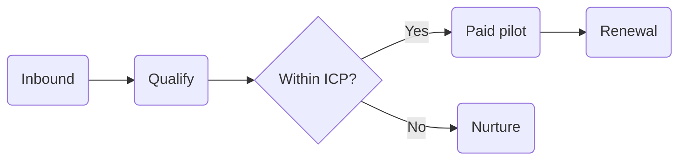

**What the syntax is doing.** `@{ shape: rounded, label: "..." }` sidesteps the
bracket-balance trap that `A[Revenue (ARR)]` walks into, because the label is a quoted
scalar rather than a bracket body. `{"..."}` is a decision node, and §4 rounds it with
everything else since it targets `.node` and not a shape class. Edge labels go in pipes:
`-->|Yes|`. Cap a full slide at 12 nodes; crossing edges, not node count, are what kill it.

#### 7.1.2 Sequence: what happens on the buyer's click

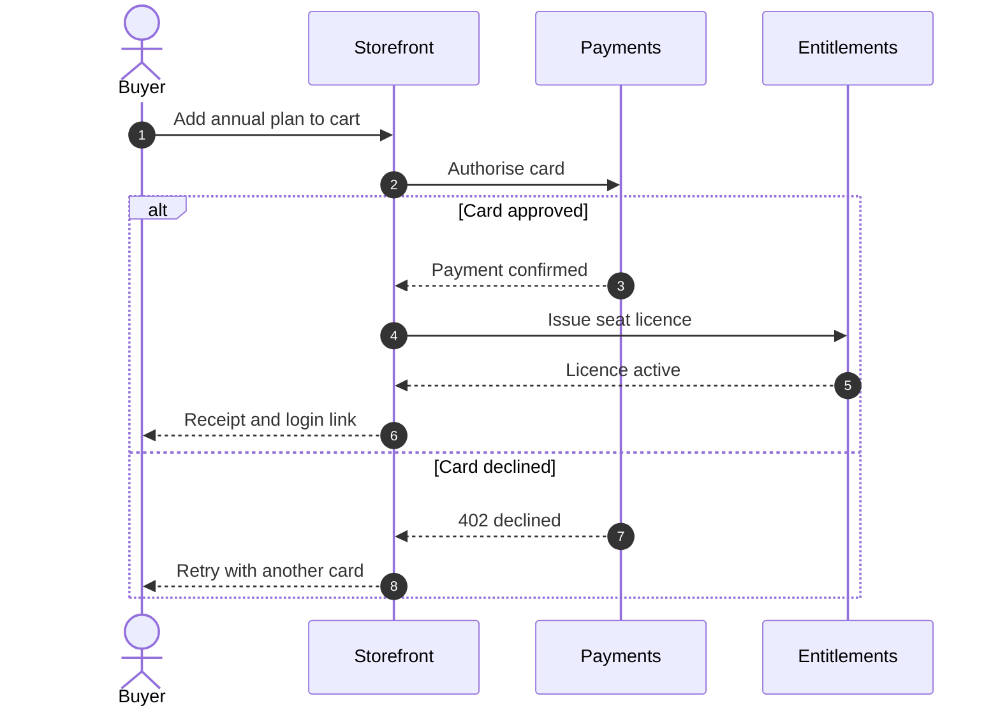

**What the syntax is doing.** `as` renames a participant, and you must declare every one:
an undeclared actor is created implicitly with a name you did not choose. `->>` is a solid
arrow and `-->>` a dashed one, and that pair is the only thing separating a call from a
return. `alt` and `else` wrap the branch, and their labels go on the keywords, not the
arrows.

**Declare at most five participants:** past that the lifelines go thin, the labels collide,
and six measure 14.9px where four give 16.0px (§8). Its arrowheads are black without the
addendum, because this type emits a `<marker>` with no class for §4's `.marker` rule to
match.

#### 7.1.3 State: how a subscription moves through stages

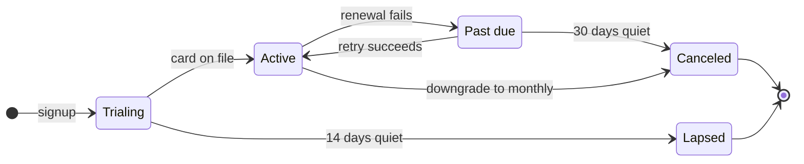

**What the syntax is doing.** Ids print verbatim, so `Past_Due` renders with its underscore
on screen; `state "Past due" as PastDue` is the alias that fixes it, and the idiomatic id
is `PastDue` with no punctuation at all. The text after a colon is the transition label
and is where the business content lives: "30 days quiet" says more than the state name does.

#### 7.1.4 Use case: feature scope and actor boundaries

```mermaid
---
config: {look: classic, fontFamily: 'Nunito, Inter, sans-serif'}
---
usecase-beta
    systemBoundary plat("Order platform")
        A("Place an order")
        B("Apply a discount")
        C("Rotate API keys")
        D("Export invoices")
    end
    actor Buyer("Buyer")
    actor Admin("Workspace admin")
    actor Billing("Billing contact")
    Buyer -- A
    Admin -- B
    Admin -- C
    Billing -- D
    A ..> : include B
    C ..> : extend A
```

**What the syntax is doing.** Three things run backwards from what you would guess.
`actor Name("Label")` takes parentheses; `as` is a parse error. The system boundary takes
**no braces**: keyword, name, members, `end`, and a `{` on the header line fails on the
brace. And `..>` is followed by a colon and the keyword, with the target after it, so it
reads `A ..> : include B`.

#### 7.1.5 C4 context: one system as a black box

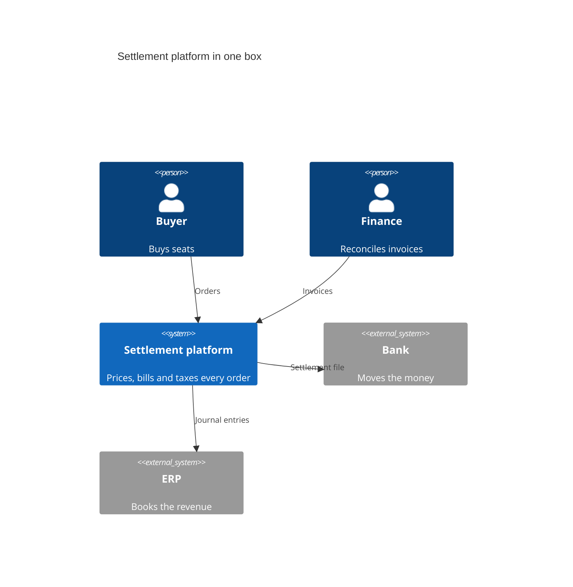

**What the syntax is doing.** The three argument positions are id, label, then description,
and only the first is referenced elsewhere. `Person`, `System` and `System_Ext` are the
kinds, and the `_Ext` suffix is what draws an external system. `Rel` takes source, target
and a relationship label, and that label is a business sentence ("Settlement file") rather
than a verb.

Only `C4Context` survives a slide; the container and component levels are far too dense at
slide scale. Keep it to five or six elements, expect small type (§8 has the letterbox it
cannot escape), and ship the addendum, since its arrowheads are black without it.

#### 7.1.6 Architecture: services and groups


**What the syntax is doing.** `service` is a mandatory keyword, and `gw[API gateway]`
without it fails with `Expecting token of type ':'`, a confusing error because the line looks
complete. `in <group>` nests a service, and the groups are what this type is for. An edge is
`id:PORT --> PORT:id` with the port `L`, `R`, `T` or `B`, so `web:B --> T:gw` is the bottom
of the storefront to the top of the gateway. `align row a b` pins services onto one row,
the only lever on the layout, since this type is a fixed grid.

Leave the `(icon)` off deliberately. Only `database`, `server`, `disk`, `internet` and
`cloud` are registered in the base build, each a hardcoded `#087ebf` square §4 cannot reach,
and an unregistered name falls back to an unbundled pack and renders `?`. A quoted string is
no escape hatch, because `"API"` in that position is a lexer error. Its nodes are `.node-bkg`
rather than inside `.node`, so their strokes stay black without the addendum, which paints
that class; and its corners are sharp because CSS cannot round them.

### 7.2 Order and time

#### 7.2.1 Gantt: a launch plan with dependencies

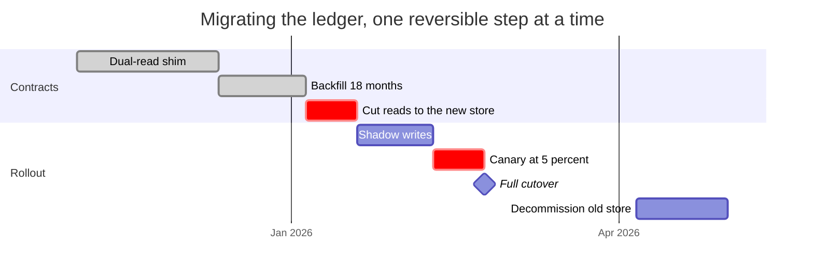

**What the syntax is doing.** `dateFormat` sets the input format, `axisFormat` the label
format. Durations take a `d` suffix, explicit dates take ISO, and `after <id>` is the
dependency. The comma-separated status list is where the state lives: `done`, `crit`,
`active`, or nothing, and `:milestone` draws a diamond at zero days.

**Its task colours cannot be configured, and the fix is CSS.** `initialize()`, frontmatter
and `%%{init}%%` have no effect on either the `ganttTask*` theme-variable names or the
unprefixed `taskBkgColor` names: a `:done` bar renders `#D3D3D3` and a `:crit` bar pure
`#FF0000` with a 2px `#808080` border. The renderer reads `getConfig().gantt`, which no
per-diagram route populates, so the only lever is the class names it injects. The addendum
repaints them: `done0`-`done3` at `--p5`, `crit0`-`crit3` at `--p3`, `task0`-`task3` at
`--surface`, all with a 1.5px hairline.

Not for phases with no dates, which is what `DESIGN.md`'s `.timeline` is for and what the
next example is the fallback for.

**A roadmap with relative horizons is still a Gantt, and this is the most common place
authors get it wrong.** "Prove the answer in six months, compound the data in the next six,
sell upward in the last six" is a plan against elapsed time, not a set of undated phases, and
`.timeline` throws away the two things that make a roadmap a roadmap: the *relative lengths*
and the *sequencing*. A row of equal dots on a rail says the three horizons are the same
length, which is a claim, and a false one. So anchor a Gantt to one stated base date, run
the durations, and print that date on the slide. The anchor should come from something the
deck already asserts, not from today. Three things keep it honest:

- **`tickInterval 3month` is not optional.** Without it every task boundary gets a tick and
  a six-month axis becomes eighteen unreadable labels.
- **`todayMarker off`** unless the deck genuinely wants a now-line. On a roadmap slide it
  lands between two bars and reads as a deadline.
- **Name the base date in the caption or the readout**, in words, not only in the axis. A
  Gantt invents an axis; the audience cannot check an axis they were never told how to read.

#### 7.2.2 Timeline-shaped flow: phases with no dates

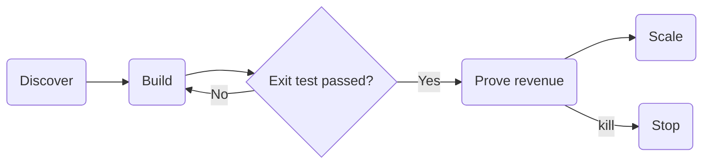

**What the syntax is doing.** A flowchart, not a Gantt, and the distinction is the point: no
dates anywhere, only order. What it buys over `.timeline` is the loop back edge and the
exit gate, so a phase can fail its own test and re-enter, and a phase can be killed. Quoted
edge labels are fine; the bracket trap only applies to `A[Revenue (ARR)]` node labels.

If the phases have no gates and no loops, stop and use `DESIGN.md`'s `.timeline`, which is
smaller, needs no JavaScript and stays legible as text. A Gantt is wrong here for the same
reason it is wrong for any undated plan: it invents a calendar you do not have.

### 7.3 Proportion and position

Only when the number itself is the argument. A single dominant share wants `.ring`, a rank
of similar magnitudes wants `.meter` or `.vbars`, and a signed change wants `.waterfall`; a
Mermaid chart answers when there are enough parts that a position on a shared scale is the
message.

#### 7.3.1 Pie: one composition of a whole

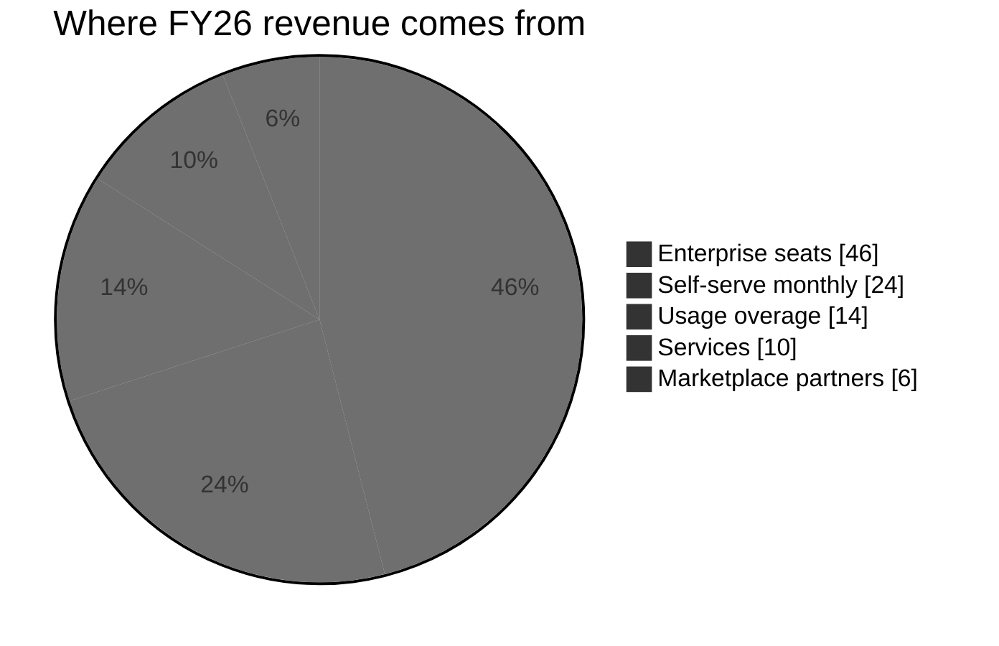

**What the syntax is doing.** Every label is quoted, and that is not style: an unquoted
label is a lexer error even for one plain word, and so is a negative number, so losses never
go in a pie. `showData` prints the percentage inside each slice. The palette is in the
directive because frontmatter drops `themeVariables` (§4); left alone the slices derive from
`primaryColor`, so on this deck they come out white, `#F3F7F7` and `#E6E6E6` with a 2px
black ring.

**The five values are `--p1` to `--p5`, and the hairline is load-bearing.** Measured against
`#F3F7F7`, no two of those pastels are more than 1.18:1 apart and `--p1` against `--p5` is
1.01:1, the same colour. In a five-slice pie the last slice sits next to the first, so
without a separator the smallest disappears into the largest. The 1.5px ink-at-12% ring is
the deck's own hairline, not a new colour. The outer ring is a separate element again, so
`pieStrokeColor` leaves it black without the addendum, which paints `.pieOuterCircle`.

Two slices are not a pie, they are `.compare`; close sizes want `.meter`, since readers
compare areas badly; and if one share dominates the honest shape is `.ring`.

#### 7.3.2 Treemap: structure and magnitude at once

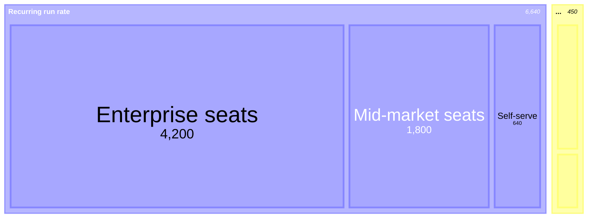

**What the syntax is doing.** Indentation is the hierarchy and the leaves carry the values,
so a leaf without a number is dropped rather than rejected, with the root total quietly
changed, so recount against the source. Quote every label, values must be positive. §4 also
falls short here without being wrong: it paints `.treemapSection` and `.treemapLeaf`, which
no §4 selector names.

One level wants `.meter` or a `dtable`, and three levels will not fit a slide. Unlike the pie,
the areas are directly comparable because the rectangles share an edge, which is the real
reason to prefer this type when the numbers matter more than the share.

#### 7.3.3 Quadrant chart: two axes that both matter

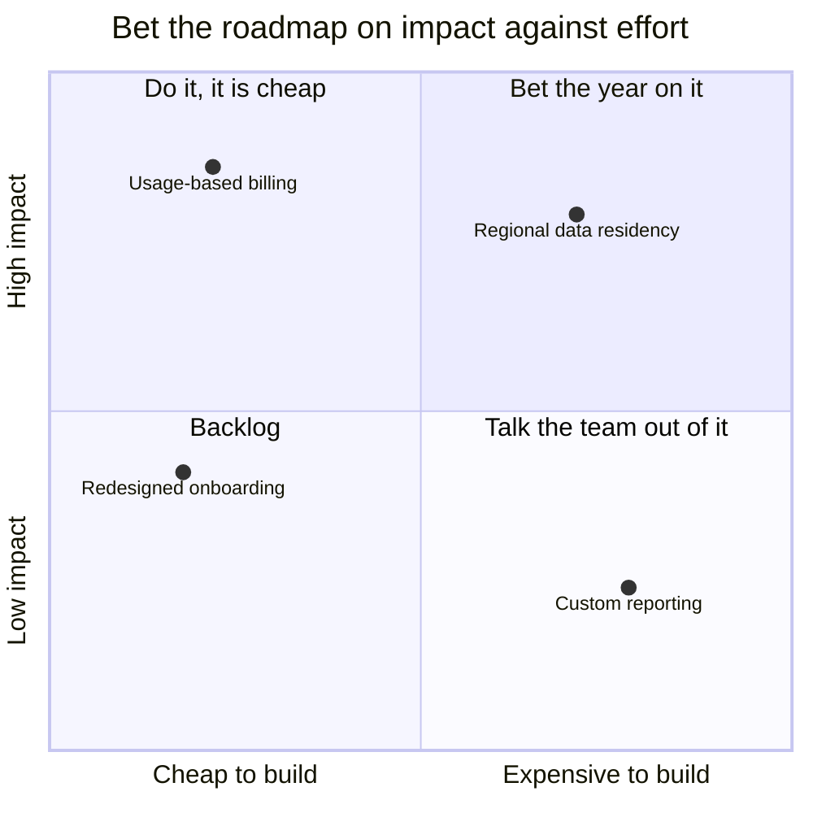

**What the syntax is doing.** The numbering runs counter-intuitively: 1 is top right, 2 top
left, 3 bottom left, 4 bottom right. `x-axis` takes left then right and `y-axis` bottom then
top, both with `-->`, which is why "Low impact --> High impact" puts low at the bottom. The
point syntax is `"Label": [x, y]`, both coordinates 0 to 1 and nothing clamping them, so 1.4
is accepted and silently off the canvas.

If only one dimension varies, `.vbars` or a `dtable` is the right shape, and past about six
points the labels collide and the chart is a cloud.

#### 7.3.4 XY chart: a real numeric axis

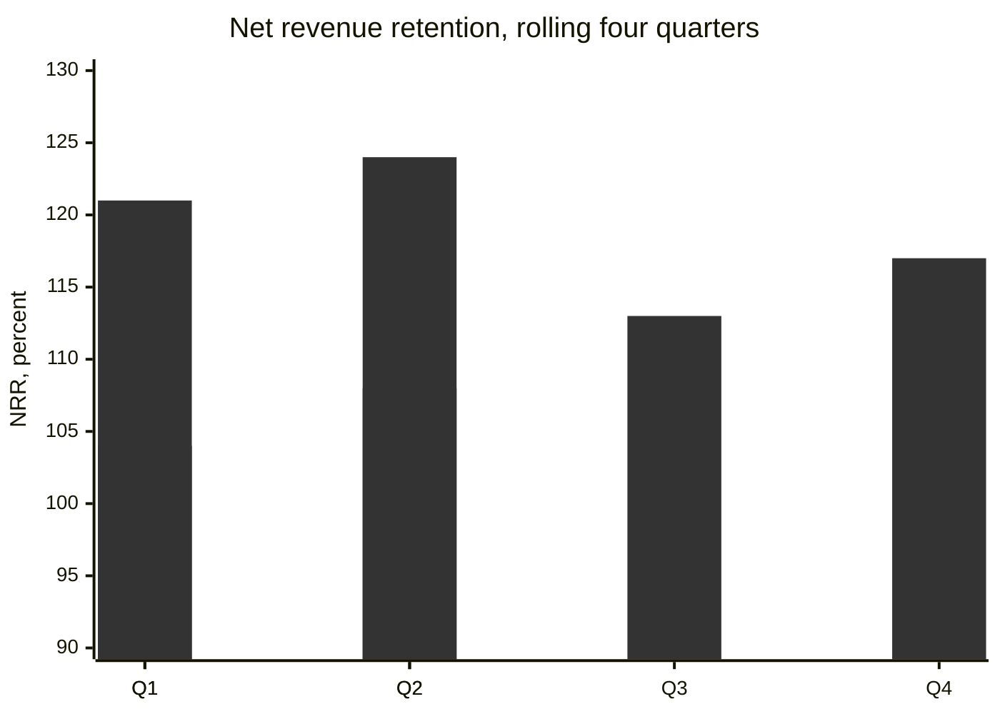

**What the syntax is doing.** The y-axis takes a title, a minimum and a maximum and nothing
else: `y-axis "Low" --> "High"` is a parse error, so the y-axis cannot be categorical. The
x-axis does take a category list. `bar` and `line` take parallel value lists on one x-axis,
so the two series here are the same six numbers drawn twice on purpose. The palette is a
directive because frontmatter drops it (§4), and the key is nested:
`themeVariables.xyChart.plotColorPalette`, not `config.xyChart`.

**The default first series colour is a cream that vanishes.** The 12.0.0 default palette
begins `#FFF4DD`, which is 1.01:1 against this canvas, so an unconfigured bar chart is
invisible and still exports cleanly. The two values above are `--p1` and `--p4`, and the
directive is what puts them there. Prefer this type to a radar for the same comparison,
because both axes are labelled and only one polygon has to be read.

#### 7.3.5 Radar: one shape on six axes

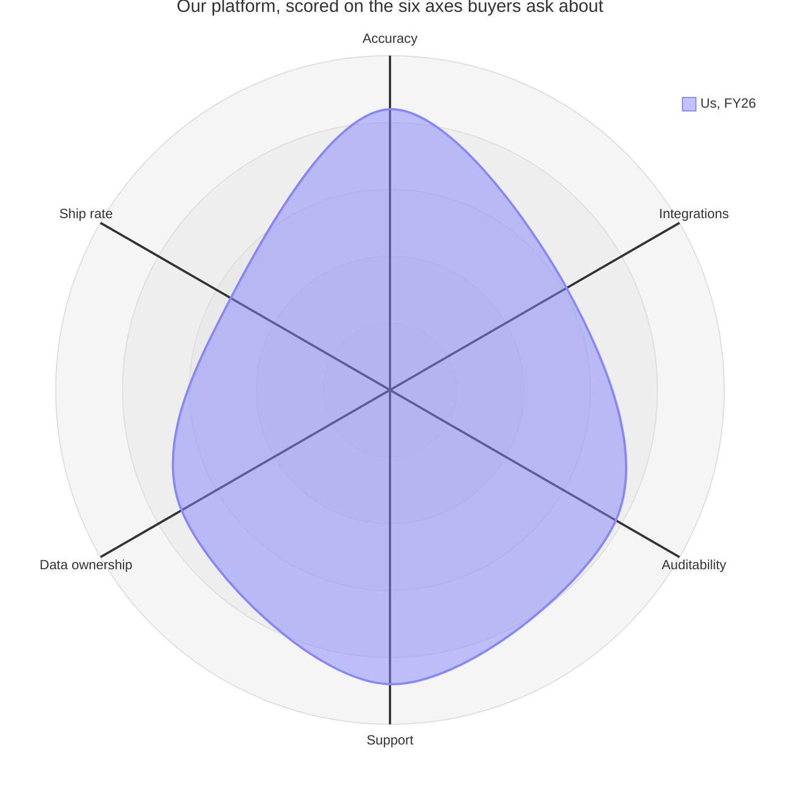

**What the syntax is doing.** `axis` declares every spoke, comma-separated, each with a
short id and a readable label. `curve` takes a label then the values in braces, in axis
order. `max` and `min` fix the outer and inner radius and you should always set both,
because the default ring makes a 55 look like a 90. This example carries **one** curve,
deliberately.

**Every curve comes out the same grey.** Measured: `radarCurve-0` and `radarCurve-1` both
render `#BFBFBF` at 0.5 fill opacity, and `themeVariables.radar.plotColorPalette` does
nothing. So a two-curve radar cannot be read, and the addendum has to hand-paint
`.radarCurve-0` and `.radarCurve-1` separately. The graticule is `#DEDEDE` and the axis
lines are black, neither of which §4 reaches, and both are in the addendum for the same
reason.

Use it sparingly and with one curve. It is hard to read by construction, its area scales with
the square of the value so a small difference looks enormous, and being always square it
letterboxes a little harder than the C4 does (§8). A labelled axis does better.

#### 7.3.6 Sankey: quantities flowing

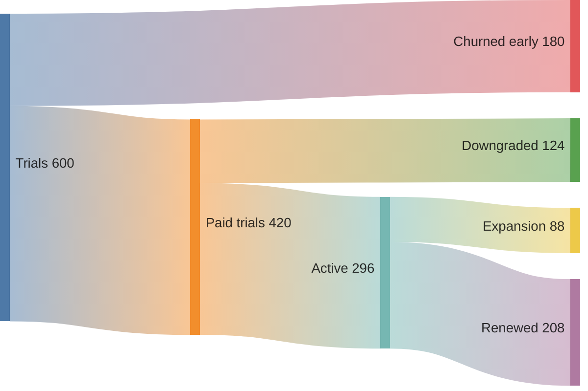

**What the syntax is doing.** Not Mermaid syntax at all but CSV: exactly three columns,
`source,target,value`, no header row, and a fourth column is a parse error (`Expecting
'COMMA', got 'EOF'`). Node names repeat verbatim on every line, which is how a node is
declared, and the value is a count of accounts or dollars, not a percentage, since the link
width is the value.

**Its colours are gradients, and they are not tokens.** Each link is a two-stop gradient
from a fixed categorical set rather than from `--p1` to `--p5`. All the stops are mid-tone,
so nothing disappears, but the pairing is arbitrary and a link's colour does not identify its
node, so the node names have to be on the diagram. It also renders at a fixed 600x400, so it
letterboxes on width and sits in a lot of empty canvas.

Use `.funnel` instead when the stages are strictly sequential and conversion per stage is
the number to read, since a funnel prints those percentages and a Sankey does not.

### 7.4 Hierarchy and structure

#### 7.4.1 Tree view: a hierarchy of names with no quantities


**What the syntax is doing.** Indentation is the structure, and a trailing `/` on a parent
line makes it a folder rather than a leaf. `##` starts the description to the right of the
label. There is no org chart type in Mermaid and this is the nearest thing to one, which is
worth saying on a slide that needs an org chart.

**Its own colours are hardcoded black and green, and nothing overrides them.**
`labelColor` and `lineColor` default to `black` and `descriptionColor` to `#6a9955`, and
the styles are read from a config captured before any per-diagram setting applies, so
`config.treeView` in frontmatter, `%%{init}%%` with `treeView`, and
`themeVariables.treeView` leave the output on pure black. That is the one failure §4 says
should be structurally impossible, and the addendum below is the only route back. Leave
`showIcons: false`, since icon packs are not bundled and an unregistered name renders `?`,
and leave `rowIndent` at its default, because 10 renders a stamp rather than a tree.

This example puts the percentage in the folder name rather than trusting a quantity the type
cannot draw, which is the honest workaround. If the numbers matter, use a treemap.

#### 7.4.2 Mindmap: a taxonomy or capability map

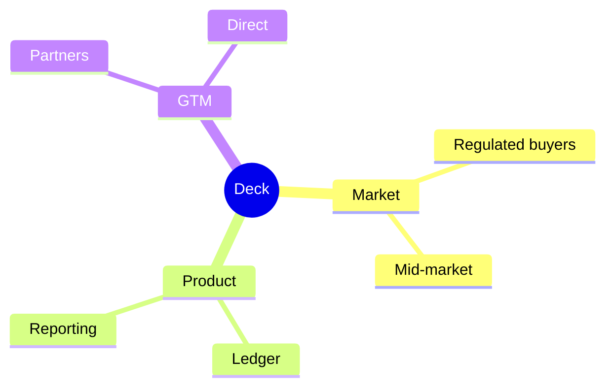

**What the syntax is doing.** Indentation again, with `root((Label))` for the centre node
and a shape per node otherwise. This is the one type with a force layout, so the same source
rearranges itself between builds and a slide using it is not byte-identical from one export
to the next. Shapes cannot be themed, and the branch paths carry no class, so §4's
`.edgePaths .path` misses them and they arrive at `#BFBFBF`.

A tree view is better when the hierarchy is a strict tree, because a mindmap is radial and
the reader has to trace back to the root to know what a leaf belongs to. Mindmaps are also
the one type §8 measured going catastrophically wrong under a wrong sizing rule, so read
that before shipping one.

### The addendum nine types need

§4 is not sufficient on its own, and the gaps are not all the same kind. Nine types in all:
three (`gantt`, `radar-beta`, `treeView-beta`) paint themselves with colours that
`initialize()`, frontmatter and `%%{init}%%` all fail to reach; six more draw something §4's
selectors cannot name. `architecture-beta` uses `.node-bkg` rather than `.node`;
`sequenceDiagram` and `C4Context` emit a `<marker>` with no class, so `.marker` never matches
and the arrowheads stay black; the pie's outer ring is a separate element from its slices;
the treemap uses `.treemapSection` and `.treemapLeaf`; the mindmap's branch paths carry no
class. The Gantt's axis and grid join its bars in the same block.

Ship this block next to §4, not inside it. Together they remove a pure red Gantt bar, a
black tree view label, a grey radar polygon, black sequence and C4 arrowheads, a mid-grey
treemap and grey mindmap branches.

```css
/* Section 7 addendum. Nine diagram types draw themselves with colours, classes or
   markers that the section 4 block cannot reach. Same two rules as section 4:
   anchor on .mmdwrap, and carry !important, because the injected rules are
   ID-scoped and an ID beats a class. */

/* architecture-beta draws nodes as .node-bkg, not inside .node */
.mmdwrap .node-bkg{fill:var(--surface)!important;stroke:rgba(var(--ink-rgb),.12)!important;stroke-width:1.5px!important}

/* sequenceDiagram and C4Context emit <marker> with no class at all, so
   section 4's .marker rule never matches them and the arrowheads stay black */
.mmdwrap marker path,.mmdwrap marker polygon,.mmdwrap marker rect{
  fill:var(--muted)!important;stroke:var(--muted)!important}

/* the pie's outer ring is not one of the slices */
.mmdwrap .pieOuterCircle{fill:none!important;stroke:rgba(var(--ink-rgb),.12)!important;stroke-width:1.5px!important}

/* treemap: sections are clusters, leaves are nodes */
.mmdwrap .treemapSection{fill:rgba(var(--ink-rgb),.05)!important;stroke:rgba(var(--ink-rgb),.10)!important;stroke-width:1.5px!important}
.mmdwrap .treemapLeaf{fill:var(--surface)!important;stroke:rgba(var(--ink-rgb),.12)!important;stroke-width:1.5px!important}

/* mindmap branch paths have no class, so .edgePaths .path misses them */
.mmdwrap .edgePaths path{stroke:var(--muted)!important;fill:none!important}

/* gantt: axis, grid, and the task bars nothing can configure */
.mmdwrap .domain,.mmdwrap .tick,.mmdwrap .tick line{stroke:rgba(var(--ink-rgb),.10)!important}
.mmdwrap .tick text{fill:var(--ink)!important}
.mmdwrap .task0,.mmdwrap .task1,.mmdwrap .task2,.mmdwrap .task3{
  fill:var(--surface)!important;stroke:rgba(var(--ink-rgb),.12)!important;stroke-width:1.5px!important}
.mmdwrap .done0,.mmdwrap .done1,.mmdwrap .done2,.mmdwrap .done3{
  fill:var(--p5)!important;stroke:rgba(var(--ink-rgb),.10)!important;stroke-width:1.5px!important}
.mmdwrap .crit0,.mmdwrap .crit1,.mmdwrap .crit2,.mmdwrap .crit3{
  fill:var(--p3)!important;stroke:rgba(var(--ink-rgb),.12)!important;stroke-width:1.5px!important}
.mmdwrap .active0,.mmdwrap .active1,.mmdwrap .active2,.mmdwrap .active3{
  fill:var(--p1)!important;stroke:rgba(var(--ink-rgb),.12)!important;stroke-width:1.5px!important}

/* treeView-beta */
.mmdwrap .treeView-node-label{fill:var(--text)!important}
.mmdwrap .treeView-node-line{stroke:rgba(var(--ink-rgb),.12)!important}
.mmdwrap .treeView-node-description{fill:var(--ink)!important}

/* radar-beta */
.mmdwrap .radarGraticule{stroke:rgba(var(--ink-rgb),.10)!important;fill:none!important}
.mmdwrap .radarAxisLine{stroke:rgba(var(--ink-rgb),.28)!important}
.mmdwrap .radarCurve-0{fill:rgba(37,99,235,.10)!important;stroke:var(--accent)!important;stroke-width:2px!important}
.mmdwrap .radarCurve-1{fill:rgba(var(--ink-rgb),.06)!important;stroke:var(--muted)!important;stroke-width:2px!important}
.mmdwrap .radarLegendBox-0{fill:var(--accent)!important;stroke:none!important}
.mmdwrap .radarLegendBox-1{fill:var(--muted)!important;stroke:none!important}
```

## 8. Layout traps, measured

**Sizing.** Mermaid emits `width="100%"`, a `viewBox`, and an **inline**
`style="max-width: <natural>px"`, so a stylesheet rule without `!important` loses,
silently. All four `!important` below are load-bearing, and the anchor is `.mmdwrap`
for the same reason as §4:

```css
.mmdwrap{width:100%;height:100%;display:flex;
         align-items:center;justify-content:center;overflow:hidden}
.mmdwrap svg{width:100%!important;height:100%!important;
             max-width:none!important;max-height:none!important}
```

Forcing the SVG to the band and clearing both max constraints lets the default
`preserveAspectRatio="xMidYMid meet"` letterbox the drawing inside it. Measured across
16 diagram types in a 1680x640 band, this is the only recipe that both fills and never
overflows: `max-width:100%!important; height:auto` overflows 5 of 8, because
`height:auto` drops the height cap and a 122x456 mindmap became 1405x5994, silently
clipped. `width:auto;height:auto` never grows past natural size, and `object-fit:
contain` on an inline SVG does nothing at all.

**Legibility is measured, not assumed.** `qa-matrix.mjs` reads each diagram's `viewBox`,
computes the letterbox scale against its band, derives the projected size of the smallest
text, and fails below **14px**, printing the number either way. Read the number, not the
verdict: a diagram at 15px is green and still not good. The floor is 14 because Mermaid's
own smallest default label is 16 units, so 14 is where a diagram may be letterboxed to 0.875
of its default and no further, while a 16 floor would forbid the letterboxing the recipe
above depends on. And when a diagram fails that number, the fix is not to shrink it: split
it across two slides, move it to the appendix, or replace it with a deck-native treatment
such as `.timeline` or `.meter`, because a diagram nobody can read is worse than a bullet.

**Composition is measured too, and it is the other half of the check.** The same
script reports `fills N% of band`: the share of the band's area the drawing
occupies after the letterbox, and it fails below **25%**. Legibility and fill are
independent, and the gap between them is where most bad diagrams live. That
1465x70 ribbon in a 1432x540 band letterboxes to 0.978, projects a passing 15.6px
and fills 13% of the band: one number says the diagram is readable, the other
says the slide is empty, and only the second is why a reviewer hands a diagram
back. For reference, measured against this deck's bands: a Gantt in a matching
band 100%, a four-participant sequence diagram 96%, C4Context 63%, a pie 60%.
§3a is the fix, and it is about choosing a direction, not about resizing.

Two shapes cannot be improved by trimming their contents. `C4Context` is 1148x699 and
`radar-beta` is always 700x700, whatever you put in them, so in a 1680x640 band both
letterbox to about 0.915 and project 16px labels to 14.6px. Everything else in §7 lands
between 16.0px and 52.2px.

**`direction LR` inside a subgraph is ignored when an edge crosses its boundary.**
Mermaid hands the whole graph to the layout engine as one unit and the subgraph's own
direction goes with it. No parse error, no page error, clean PDF. Measured on one
three-node fan in a `flowchart TB`: with the subgraph, 546x769 against a band of aspect
2.58, letterboxing on height, with 16px labels projecting at 13.5px; without the wrapper
the same graph is 1306x211 and the same labels project at 20.6px. The workaround is to
attach the edge to the subgraph itself rather than to its members and lay the members out
with invisible links, but usually the better fix is to drop the subgraph and encode the
grouping in labels. Detect it by eye: honoured means wide and short, the bug is tall and
narrow.

**Label clipping is real and invisible.** Mermaid measures a label, writes that width
onto the `<foreignObject>`, and Chromium clips to it, so a webfont landing late makes
the tail of the longest line vanish mid-word with no error at all: measured up to 19.86
units of ink outside its own box on a 16px label. The `overflow:visible` line in §4
closes it and awaiting fonts first removes the ordinary cause. Do both.

## 9. Troubleshooting

| Symptom | Cause | Fix |
|---|---|---|
| `No diagram type detected ... for text: #mermaid-<id>{font-family` | `initialize()` ran after an `await`, so Mermaid's auto-start injected its config `<style>` into your nodes first. | Call it synchronously at parse time. See §5. |
| `Parse error on line 1: ---config: look:` | A `<div class="mermaid">` collapsed the newlines. | Use `<pre class="mermaid">`. |
| Blank container, or an error card reading "Syntax error in text" | `render()` does not throw on a parse error, it renders one and fulfils. | `mermaid.parse()` first, then assert no `.error-text` or `.error-icon` element. Set `data-mermaid-error` in the catch and have the export script fail on it. |
| **Black ink, black fills or hard blue borders on a light canvas** | The theming block is missing, or anchored on `.mermaid`, which the render step deletes. | Ship §4 and anchor it on `.mmdwrap`. |
| A theme variable seems to be ignored, or an `%%{init}%%` directive parses cleanly and changes nothing | Frontmatter delivers `config` and drops `themeVariables`, and a directive must be strict JSON, so a single-quoted one is accepted and discarded. | Put `themeVariables` in `initialize()` or in a double-quoted `%%{init}%%` directive. See §4. |
| Drop shadows, a wrong typeface, navy strokes | The `neo` look, the 12.0.0 default for ten types including flowchart, sequence and state. | `look: classic` in the diagram's **frontmatter**. `initialize()` is ignored for it. |
| `No diagram type detected ... for text: radar`, or `Expecting token of type 'architecture-beta'` | A missing `-beta`. Add it where the keyword needs it: `usecase-beta`, `sankey-beta`, `radar-beta`, `treeView-beta`, `venn-beta`, `swimlane-beta`, `wardley-beta`, `cynefin-beta` and others. | Add it. The capital V in `treeView` is part of the keyword. |
| Pie renders white and grey anyway, or has a black ring | `pie1`..`pie12` in frontmatter are dropped, and the default 2px black stroke is back. | Put the palette plus both `*StrokeColor` and `*StrokeWidth` in an `%%{init}%%` directive, or in `initialize()`. See §7.3.1. |
| `Lexer error ... unexpected character: ->E<-` in a pie | An unquoted label, which fails even for one plain word. Losses are rejected too. | Quote every label: `"Enterprise" : 62`. Losses do not go in a pie; use `.compare`. |
| Gantt bars are grey with one pure red, a radar curve is invisible or two curves match, a tree view has black labels and a green description | Three types read their colours from a config that no per-diagram route populates. Measured: `:done` is `#D3D3D3`, `:crit` is `#FF0000`, every radar curve is `#BFBFBF` at 0.5 opacity, and the tree view is `black` on `#6a9955`. | Ship the §7 addendum, and use one radar curve. |
| `Expecting 'COMMA', got 'EOF'` in a sankey | Not exactly three CSV columns. | `source,target,value`, no header row. |
| `Expecting 'SQE' ... got 'NODE_STRING'` in a flowchart | An unbalanced bracket in a label, e.g. `A[Revenue (ARR)]`. | Quote it, or use `A@{ shape: rounded, label: "Revenue (ARR)" }`. |
| `got 'ARROW_DELIMITER'` in an xychart | A categorical y-axis. | `y-axis "Low" --> "High"` is not allowed. Use `y-axis title min --> max`. |
| An xychart's bars are invisible | The first default series colour is `#FFF4DD`, which is 1.01:1 against this canvas. | `themeVariables.xyChart.plotColorPalette` in a directive or in `initialize()`. |
| `got 'ARROW_DELIMITER'` in a treemap | An unquoted section or leaf name, or a missing or negative value, which drops the leaf silently. | Quote every label, give every leaf a positive number, and recount the total. |
| `Expecting token of type ':'` in an architecture diagram | `service` is a mandatory keyword, so `gw[API gateway]` fails although the line looks complete. | `service gw[API gateway] in edge`. |
| A `?` glyph inside an architecture or tree view icon | Icon packs are not bundled, and an unregistered name falls back to a pack that is not there. | Omit the `(icon)` entirely, and leave `showIcons: false`. |
| `Expecting token of type COLON` or `include relationship requires use-case endpoints` in a usecase | `..>` takes a colon and the keyword before the target, `include` and `extend` need a use case at both ends, and the boundary is closed by its own `end`, so a second one is a syntax error. | `A ..> : include B`, attach actors with `--`, and use one `end` per `systemBoundary`. |
| The diagram renders tiny, overflows, or the sizing CSS does nothing | Drawing at 1:1, or `height:auto` dropping the height cap, or a rule without `!important` losing to Mermaid's inline `max-width`. | Use the full §8 block, all four `!important` included. |
| A subgraph with `direction LR` is stacked vertically | An edge crossed the boundary, so the direction was dropped. | Drop the subgraph or keep every edge inside it. See §8. |

## 10. What is verified and what is not

- **Verified.** Every Mermaid block here parses against the installed 12.0.0 package.
  The §4 block's computed values were confirmed in headless Chromium on a real deck
  with the network blocked, and the sixteen worked examples were rendered the same way,
  then re-measured with the §7 addendum applied. "It rendered" is not proof the source
  was valid, because Mermaid renders its own error card as a successful SVG, which is
  why every example was re-checked with `mermaid.parse()`.
- **Verified: three types ignore configuration entirely.** `gantt` task colours,
  `treeView-beta` label and description colours and `radar-beta` series colours were each
  tried through all three routes, and only CSS reaches them. Nine types need the §7
  addendum: those three, plus six more where §4's selectors cannot name the element.
- **Not verified: a working `registerIconPacks()` call.** The `?` from an unregistered
  name was confirmed; a successful registration was not. Leaving `showIcons: false`
  sidesteps it entirely.
- **Not verified: the C4 per-element font override, the `architecture-beta` corner
  geometry, the mechanism behind the dropped `direction LR`, and any rate for
  the `foreignObject` clip.** The triggers are measured behaviour; the reasons in
  Mermaid's layout source were not read. Treat the workarounds as unconditional.

## Pre-flight

1. The §7 addendum is present whenever the deck holds a Gantt, a radar, a tree view, a
   sequence, a C4, an architecture, a pie, a treemap or a mindmap. An unpatched `:crit` bar,
   an unpatched curve and an unconfigured XY palette all pass the render check and all fail
   this, because a diagram that disappears is still a successful SVG.
2. `check-visuals.mjs` passes on the deck: the library is vendored next to it,
   `initialize()` runs with `startOnLoad:false`, every source is parsed before render, and
   the render is registered with `defer()`. A deck that reaches a CDN, or that renders
   without registering, fails before any browser starts.
